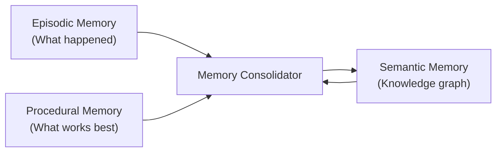
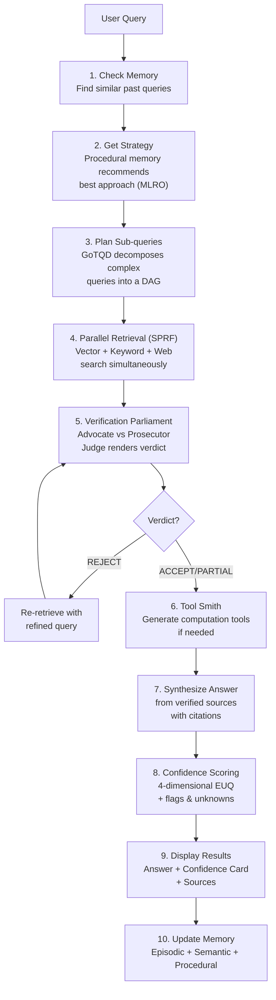
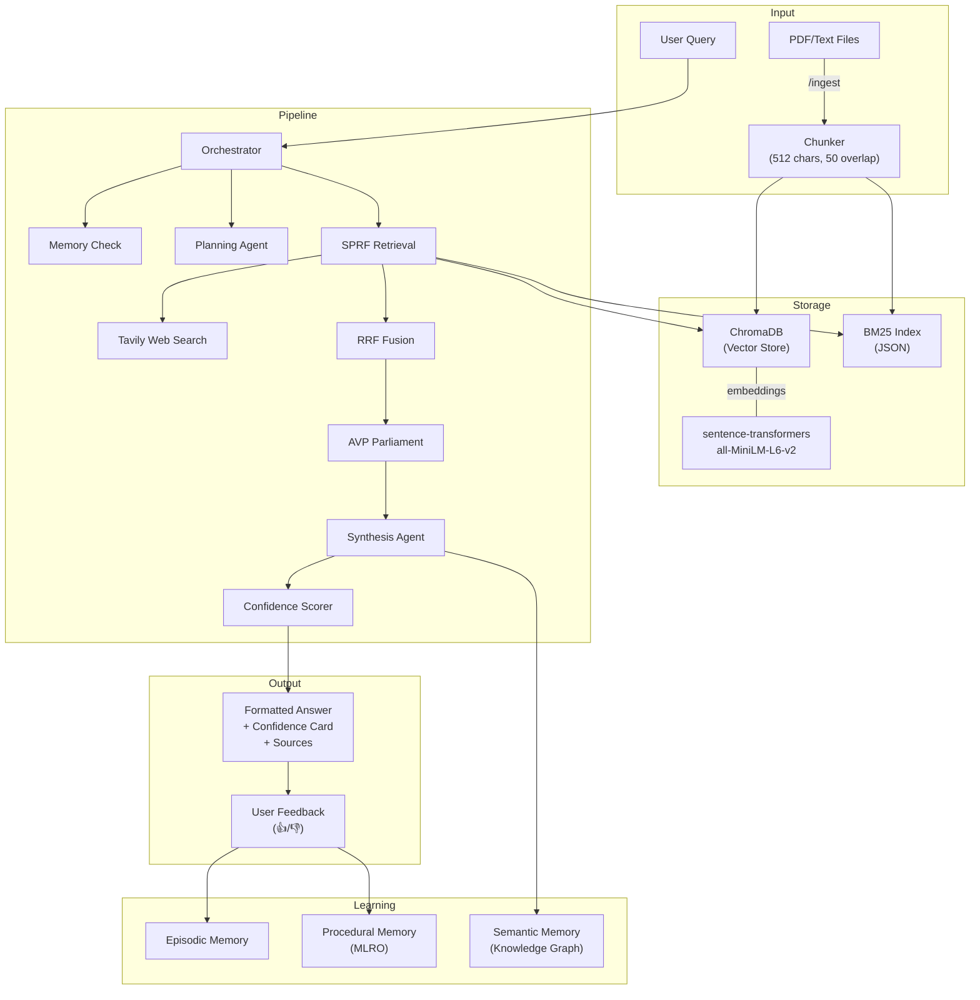

# NEXUS — Neuro-Episodic Expert Unified System

> A Multi-Agent Agentic RAG System with 7 Unique Innovations

---

## What is NEXUS?

NEXUS is a **multi-agent Retrieval-Augmented Generation (RAG)** system. Instead of a simple "retrieve → generate" pipeline, it uses **11 specialized AI agents** that collaborate through a 10-step workflow to answer questions with high accuracy, self-verification, and continuous learning.

The system ingests documents (PDF/text), stores them in a vector database, and when you ask a question, multiple agents work together — retrieving, verifying, synthesizing, and scoring the answer.

---

## Project Structure (5 Files)

```
nexus/
├── __init__.py       ← Package marker (2 lines)
├── config.py         ← Configuration + LLM Client + Embeddings + CLI Formatters
├── memory.py         ← Three-tier memory system (episodic + semantic + procedural)
├── agents.py         ← All 11 specialized agents + fusion algorithms
├── core.py           ← Message bus + Orchestrator (the brain)
└── main.py           ← CLI entry point + document ingestion
```

Plus: `.env` (API keys), `requirements.txt` (dependencies), `README.md`

---

## File-by-File Breakdown

### 1. `config.py` — Configuration, LLM, Embeddings & Formatters

This is the **foundation layer** that everything else depends on.

| Component | What it does |
|-----------|-------------|
| **Config Dataclasses** | `LLMConfig`, `EmbeddingConfig`, `RetrievalConfig`, `MemoryConfig`, `SystemConfig`, `NexusConfig` — all settings loaded from `.env` |
| **LLMClient** | Wrapper around Groq's API (OpenAI-compatible). Methods: `chat()`, `chat_with_system()`, `chat_json()`. Tracks token usage. |
| **EmbeddingEngine** | Uses `sentence-transformers` (`all-MiniLM-L6-v2`) to convert text → 384-dimensional vectors for semantic search |
| **Formatters** | Rich terminal output — `print_banner()`, `print_agent_action()`, `print_confidence_card()`, `print_answer()`, `print_parliament_verdict()`, etc. |

**Key design choice:** Groq's API is OpenAI-compatible, so we use the `openai` Python client with `base_url="https://api.groq.com/openai/v1"`. This gives us free, fast inference with `llama-3.3-70b-versatile`.

---

### 2. `memory.py` — Cognitive Memory Fabric (Concept #1)

Three-tier memory inspired by human cognition:



| Memory Type | Human Analogy | Implementation | Purpose |
|-------------|---------------|----------------|---------|
| **Episodic** | Diary | JSON list of `Episode` dataclasses | Records every interaction — query, strategy used, confidence, user feedback |
| **Semantic** | Textbook | NetworkX directed graph (`DiGraph`) | Accumulates entities and relationships from every answer into a knowledge graph |
| **Procedural** | Muscle memory | Strategy performance records | Tracks which retrieval strategies work best for each query type (MLRO — Concept #5) |
| **Consolidator** | Sleep | LLM-powered extraction | Periodically compresses episodic memories into semantic knowledge |

**How Episodic similarity works:** Jaccard similarity on word sets — `|A ∩ B| / |A ∪ B|` — fast, no embeddings needed.

**How Procedural learning works (MLRO):** Weighted scoring formula:
```
score = 0.5 × success_rate + 0.3 × avg_confidence + 0.2 × efficiency
```
Where efficiency = `1 - (tokens_used / max_tokens_seen)`. Over time, the system learns which strategies give the best results for each query type.

---

### 3. `agents.py` — All 11 Specialized Agents

Every agent inherits from `BaseAgent` which provides two LLM helper methods:
- `_llm_call(system_prompt, user_message)` → returns text
- `_llm_call_json(system_prompt, user_message)` → returns parsed dict

#### Agent Roster

| Agent | Role | Concept |
|-------|------|---------|
| **PlanningAgent** | Classifies queries and decomposes complex ones into sub-queries with dependencies | GoTQD (#4) |
| **VectorRetriever** | Semantic search over ChromaDB using cosine similarity on embeddings | SPRF (#3) |
| **KeywordRetriever** | BM25 lexical search — catches exact term matches that semantic search misses | SPRF (#3) |
| **WebRetriever** | Live web search via Tavily API for real-time information | SPRF (#3) |
| **AdvocateAgent** | Argues FOR the relevance of retrieved documents | AVP (#2) |
| **ProsecutorAgent** | Argues AGAINST — finds flaws, gaps, outdated info | AVP (#2) |
| **JudgeAgent** | Weighs both sides, renders ACCEPT / PARTIAL / REJECT verdict | AVP (#2) |
| **SynthesisAgent** | Generates the final answer with inline citations from verified sources | — |
| **ConfidenceAgent** | Scores answer reliability across 4 dimensions | EUQ (#6) |
| **ToolSmithAgent** | Dynamically generates Python functions for computation needs | SETS (#7) |

#### Fusion Algorithm (RRF)

The `reciprocal_rank_fusion()` function merges results from vector + keyword + web retrievers:

```
For each document: RRF_score = Σ 1/(k + rank_in_list)
```

where `k = 60` (standard constant from the RRF paper). Documents found by **multiple retrievers** naturally get higher scores.

`apply_diversity_penalty()` then ensures no single retriever dominates the top results.

---

### 4. `core.py` — Orchestrator (The Brain)

The **Orchestrator** is the meta-agent that coordinates the full pipeline. It:
- Initializes all 11 agents and all 3 memory systems
- Executes the 10-step query lifecycle
- Manages document ingestion into both vector and keyword indexes

The **MessageBus** provides trace ID generation and message logging for debugging.

---

### 5. `main.py` — CLI Interface

Interactive terminal interface using the `rich` library. Handles:
- Command parsing (`/ingest`, `/stats`, `/memory`, `/clear`, `/help`, `/quit`)
- Document ingestion (PDF via `pypdf`, text files) with chunking (512 chars, 50 overlap)
- User feedback collection (👍/👎) which feeds back into MLRO learning
- Error handling and graceful shutdown

---

## The 10-Step Query Pipeline



### Walkthrough Example

**User asks:** *"Compare lithium and sodium-ion batteries for grid storage"*

1. **Memory Check** → No similar past queries found
2. **Strategy** → Default: GoTQD + vector+web (comparison query)
3. **GoTQD Decomposition** →
   - Q1: "lithium battery advantages for grid storage" (independent)
   - Q2: "sodium-ion battery advantages for grid storage" (independent)
   - Q3: "compare lithium vs sodium-ion for grid" (depends on Q1, Q2)
4. **SPRF Retrieval** → Vector search finds 3 docs, web search finds 4 → fused via RRF → 5 unique docs
5. **Parliament** → Advocate: "4/5 docs directly relevant" | Prosecutor: "One doc is from 2019" | Judge: **PARTIAL** (drops the outdated doc)
6. **Tool Smith** → No computation needed
7. **Synthesis** → Structured answer with [Source 1], [Source 2] citations
8. **Confidence** → Factual: 85%, Source Agreement: 90%, Temporal: 70%, Coverage: 80% → Overall: **81%**
9. **Display** → Rich formatted answer + confidence card + source table
10. **Memory Update** → Episode recorded, entities (lithium, sodium-ion, grid storage) added to knowledge graph, procedural memory records that GoTQD+vector+web worked for comparison queries

---

## The 7 Unique Concepts

### Concept #1: Cognitive Memory Fabric (CMF)
**File:** `memory.py`

Three-tier memory inspired by neuroscience. Episodic memory records interactions, semantic memory builds a growing knowledge graph using NetworkX, procedural memory learns optimal strategies. A consolidator (like sleep) periodically compresses episodic → semantic.

### Concept #2: Adversarial Verification Parliament (AVP)
**File:** `agents.py` → `AdvocateAgent`, `ProsecutorAgent`, `JudgeAgent`

Three agents debate document quality before any answer is generated. The Advocate argues FOR, the Prosecutor argues AGAINST, and the Judge renders a verdict (ACCEPT/PARTIAL/REJECT). If REJECT, the system re-retrieves with a refined query.

### Concept #3: Speculative Parallel Retrieval + Fusion (SPRF)
**File:** `agents.py` → `VectorRetriever`, `KeywordRetriever`, `WebRetriever`, `reciprocal_rank_fusion()`

Three different retrieval methods run simultaneously. Results are merged using Reciprocal Rank Fusion (RRF) — documents confirmed by multiple retrievers get boosted. A diversity penalty prevents any single retriever from dominating.

### Concept #4: Graph-of-Thought Query Decomposition (GoTQD)
**File:** `agents.py` → `PlanningAgent`

Complex queries are decomposed into a DAG (directed acyclic graph) of sub-queries with dependencies. Independent sub-queries can run in parallel, dependent ones wait for their prerequisites. This enables multi-hop reasoning.

### Concept #5: Meta-Learning Retrieval Optimizer (MLRO)
**File:** `memory.py` → `ProceduralMemory`

The system learns which retrieval strategies work best for each query type. After every query, it records: success/failure, confidence, tokens used. Over time, it builds a performance matrix and recommends the optimal strategy using weighted scoring.

### Concept #6: Epistemic Uncertainty Quantification (EUQ)
**File:** `agents.py` → `ConfidenceAgent`

Every answer gets scored across 4 dimensions: factual accuracy, source agreement, temporal relevance, and coverage. The system also identifies explicit "known unknowns" (gaps it's aware of) and flags low-confidence areas.

### Concept #7: Self-Evolving Tool Synthesis (SETS)
**File:** `agents.py` → `ToolSmithAgent`

When a query requires computation (math, data processing, conversions), the Tool Smith dynamically generates Python functions, tests them, and registers them for future reuse. Built-in tools include `calculate` and `percentage`.

---

## Libraries Used

| Library | Purpose | Used In |
|---------|---------|---------|
| `openai` | OpenAI-compatible client for Groq API | `config.py` → `LLMClient` |
| `sentence-transformers` | Local text embeddings (all-MiniLM-L6-v2) | `config.py` → `EmbeddingEngine` |
| `chromadb` | Vector database for semantic search | `agents.py` → `VectorRetriever` |
| `rank-bm25` | BM25 algorithm for keyword search | `agents.py` → `KeywordRetriever` |
| `tavily-python` | Web search API | `agents.py` → `WebRetriever` |
| `networkx` | Directed graph for knowledge graph | `memory.py` → `SemanticMemory` |
| `rich` | Terminal UI (tables, panels, trees, colors) | `config.py` formatters, `main.py` |
| `python-dotenv` | Load `.env` configuration | `config.py` |
| `pypdf` | PDF text extraction | `main.py` → `ingest_file()` |
| `numpy` | Cosine similarity computation | `config.py` → `EmbeddingEngine` |

---

## Data Flow Diagram


